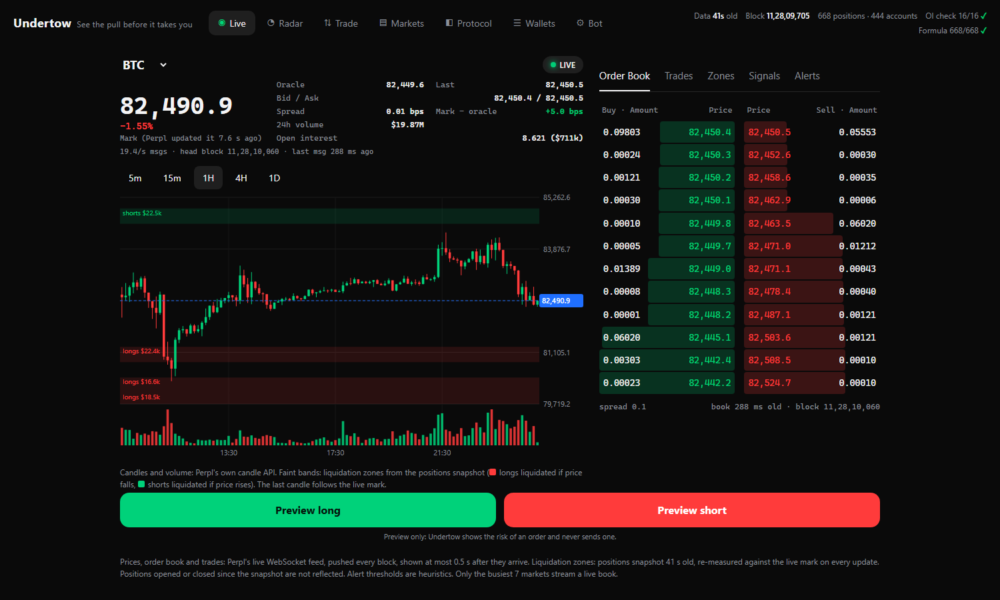
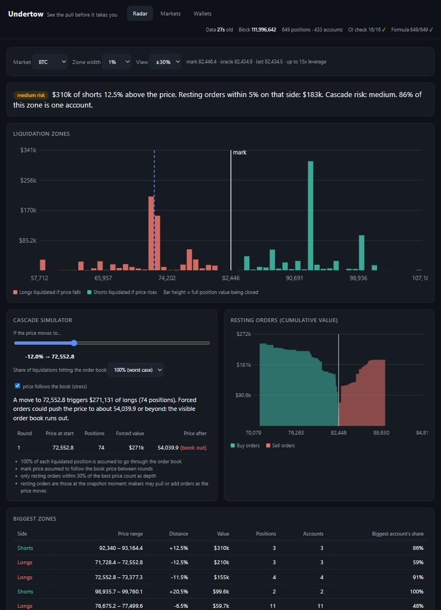
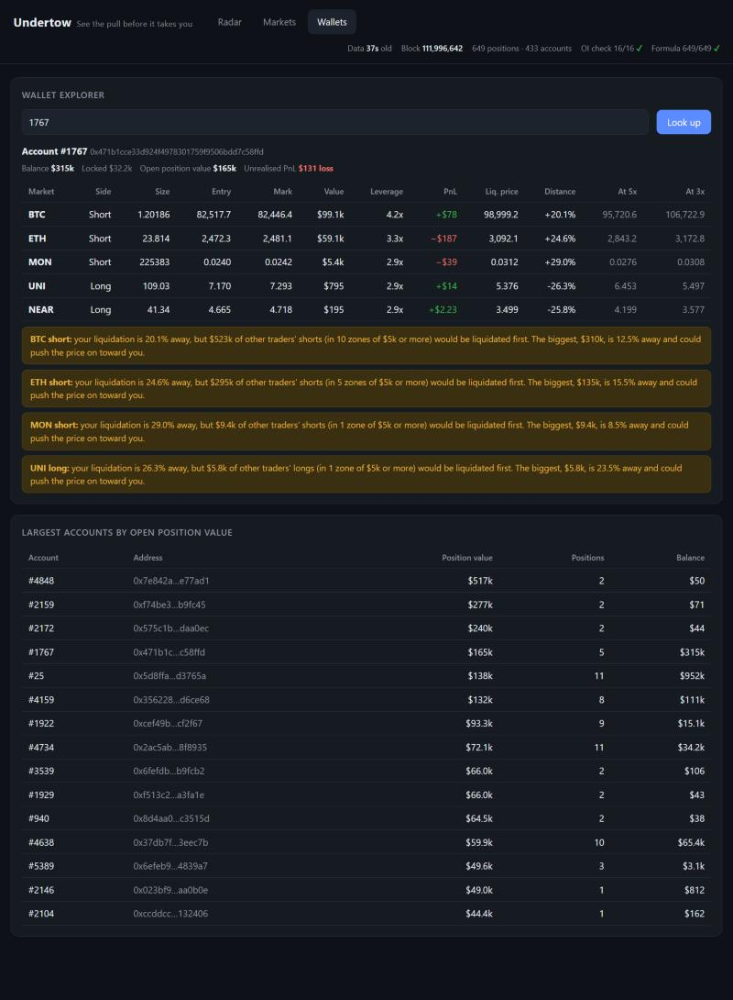
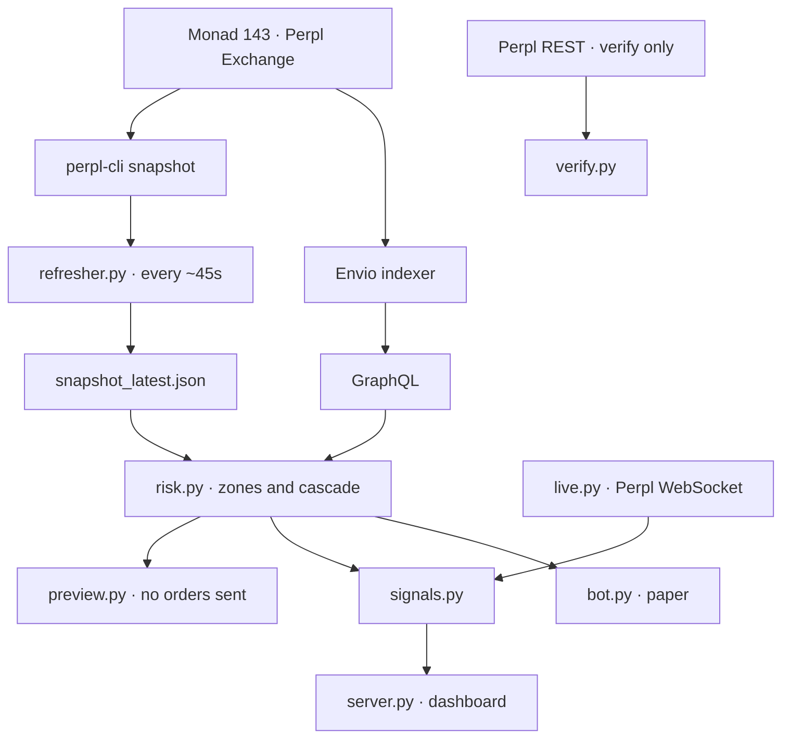
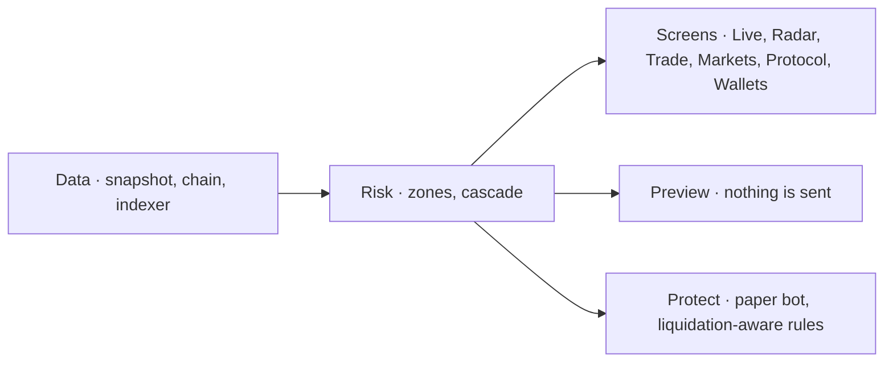

<h1 align="center">Undertow</h1>

<p align="center">
  <strong>See the pull before it takes you.</strong><br>
  Read-only liquidation radar for <a href="https://perpl.xyz">Perpl</a> on Monad.
  Every position is public, so Undertow shows where traders get liquidated and what sits between the price and you.
</p>

<p align="center">
  <a href="https://perpl.xyz"></a>
  
  
</p>

<p align="center">
  <a href="https://undertow-two.vercel.app/">https://undertow-two.vercel.app/</a>
  ·
  <a href="https://perpl.xyz">Perpl</a>
</p>

Live prices every block. Liquidation zones from a snapshot about every 45 seconds. Trade preview sends no orders.

**Live** · chart, book, trades, zone bands
**Radar** · zones, warning, cascade estimate
**Wallets** · any address: positions, path, history

## Screens

**Live**



<table>
<tr>
<td width="50%">

**Radar**



</td>
<td width="50%">

**Wallets**



</td>
</tr>
</table>

## Architecture





## Setup

Python 3, [`perpl-cli` 0.2.9](https://crates.io/crates/perpl-cli), and a Monad RPC.

```bash
pip install -r requirements.txt
cargo install perpl-cli --version 0.2.9 --locked
python -m undertow.server --refresh
```

Open http://localhost:8000. First refresh takes about a minute.

```bash
UNDERTOW_RPC=https://YOUR-RPC-URL python -m undertow.server --refresh   # if the public RPC is slow
python -m undertow.verify                                                # compare numbers with Perpl
python -m undertow.history_loader --days 7                               # wallet history beyond the default 1 day
UNDERTOW_NETWORK=testnet python -m undertow.server --refresh --port 8001
```

Live site: https://undertow-two.vercel.app/

Hosting: [docs/DEPLOY.md](docs/DEPLOY.md). Indexer: [indexer/README.md](indexer/README.md).
